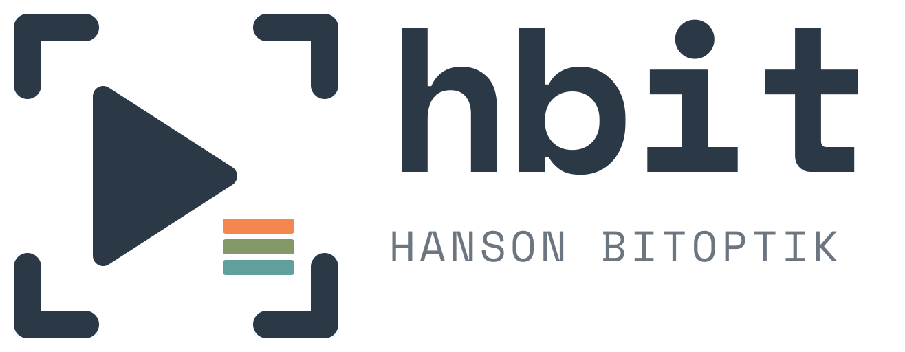

<div align="center">
  <picture>
    <source media="(prefers-color-scheme: dark)" srcset="dist/lockup/hbit-horizontal-warm-on-dark.svg" />
    
  </picture>

  <p>Single source of truth for the hbit / Hanson BitOptik logo, icons and QR code.</p>

  
  
  

  <p><a href="#assets">Assets</a> · <a href="#using-the-assets">Using the assets</a> · <a href="#changing-the-logo">Changing the logo</a> · <a href="#rules">Rules</a></p>
</div>

## Overview

The mark is a prism that is also a play button and a terminal prompt: light enters, splits into three beams and leaves as output. The viewfinder corners frame it as a camera. Together they cover what Hanson BitOptik does: photo, video and software.

`dist/` is generated by `scripts/build.py` and committed, so sites and READMEs can link to files directly. Every site pulls from a tagged release of this repository instead of keeping its own copy of the source.

## Assets

| Folder | Contents |
| --- | --- |
| `dist/mark/` | Mark only, in `warm-on-dark`, `warm-on-light`, `black` and `white`. SVG plus PNG at 64–1024 px, and a `-tile` variant with a solid background. |
| `dist/lockup/` | Mark with the `hbit` wordmark and `HANSON BITOPTIK`, horizontal and stacked. Text is outlined, so no font is needed. |
| `dist/favicon/` | `favicon.ico` (16/32/48), `apple-touch-icon.png`, `icon-192.png`, `icon-512.png`, `icon.svg`. The 16 and 32 px files are hand-placed pixels. |
| `dist/qr/` | QR code for `https://hbit.sh` in the same frame style, dark modules on light. |

| Token | Value |
| --- | --- |
| Cream | `#f3ddb3` |
| Slate | `#2b3946` |
| Ink | `#050505` |
| Beams | `#f3874e` `#859867` `#5f9f9d` |
| Typeface | Space Mono (Bold for `hbit`, Regular for `HANSON BITOPTIK`) |

## Using the assets

Always reference a tag, never `main`, so a logo change only reaches a site when it is deliberately bumped.

**READMEs and web pages:** link through jsDelivr.

```html

```

**Favicons and app icons:** copy them into the site so the browser never depends on a CDN for its icon.

```bash
curl -fsSL https://raw.githubusercontent.com/lucasfth/brand/v1/scripts/sync.sh | bash -s -- v1 public \
  favicon/favicon.ico favicon/favicon-16x16.png favicon/favicon-32x32.png \
  favicon/apple-touch-icon.png favicon/icon-192.png favicon/icon-512.png
```

<details>
<summary>Consumers</summary>

Live means the change is on `main` and the deployed site or rendered README was checked.

| Repository | Uses | Status |
| --- | --- | --- |
| `lucasfth/portfolio` | Favicons, app icons, navbar mark | Live |
| `lucasfth/littlelink` | Favicon | Live |
| `lucasfth/skaljegpaski.dk` | Favicons, app icons, README mark | Live |
| `lucasfth/lucasfth` | Profile README mark | Live |
| `lucasfth/config` | README mark | Live |

</details>

## Changing the logo

1. Edit `scripts/build.py`.
2. Run `scripts/build.sh`. It needs Nix and rebuilds `dist/`, then decodes every QR PNG and fails if one does not read back as the expected URL.
3. Commit, tag the next version (`v2`), and bump the tag in each consumer.

Set `QR_URL` to encode a different link. Decoding a rendered PNG is not a phone or print test; scan a physical proof before printing.

## Rules

- Use the mark without the corners only below 48 px. The favicon set already handles this.
- On a single colour (engraving, stamps, embroidery) use `black` or `white`, never a tinted version.
- Do not recolour the beams, stretch the mark, or re-typeset the wordmark.
- A QR code that must scan stays dark on light with its quiet zone intact.

## Licence

**Brand assets are not MIT-licensed.** The hbit and Hanson BitOptik marks and artwork are © Lucas Hanson, all rights reserved except for the limited permissions in the [root license](LICENSE) and identical [brand-use policy](BRAND-POLICY.md). Code and build/sync scripts alone are [MIT-licensed](LICENSES/MIT-code.txt). That policy permits accurate references and redistribution with unmodified software, including commercially; it does not license the marks under MIT. Space Mono in `fonts/` retains the [SIL Open Font License 1.1](fonts/OFL.txt). See [licensing scope](LICENSING.md).
